# ETL Pet: данные о фильмах

Локальный ETL-проект: загрузка изменений фильмов из PoiskKino API, хранение
исходных ответов в MinIO, обработка Spark, хранилище Greenplum и аналитические
витрины в ClickHouse. Оркестрация — Airflow. Этот README — точка входа
в документацию; описание соответствует коду и конфигурации репозитория.
Состояние запущенного стенда и объёмы данных проверяются отдельно.

## Как устроен пайплайн

```mermaid
flowchart LR
    API[PoiskKino API] --> Raw[MinIO: etl-raw / JSONL.gz]
    Raw --> Clean[Spark: проверка и очистка]
    Clean --> Parquet[MinIO: etl-cleaned / Parquet]
    Parquet --> Load[Spark: загрузка JDBC]
    Load --> Stg[Greenplum: stg]
    Stg --> Dbt[dbt: атомарная сборка]
    Dbt --> Core[Greenplum: core + mart]
    Core --> CH[ClickHouse: 8 витрин]
    CH --> BI[Apache Superset]
```



Airflow запускает эту цепочку ежедневно для UTC-интервала. Исходные страницы
публикуются с манифестом и SHA-256; downstream читает только перечисленные
в манифесте объекты. Для сохранённого raw-батча есть отдельный ручной replay DAG.

## Дашборды Superset

[Документация по дашбордам и запуску Superset](infra/superset/README.md) ·
[Все скриншоты](infra/superset/README.md#скриншоты-дашбордов)

Скриншоты сделаны в Superset на витринах с реальными данными.

- [Cinema Overview](infra/superset/screenshots/cinema-overview.png)
- [Movie Analytics](infra/superset/screenshots/movie-analytics.png)
- [Rating Comparison](infra/superset/screenshots/rating-comparison.png)

## Текущее состояние

| Часть | Что реализовано |
| --- | --- |
| Извлечение | `/movie`, `type=movie`, фильтр `updatedAt`, диапазон `votes.kp` от 1000 до 100000000; планирование партиций и лимиты страниц |
| Raw → cleaned | Проверки манифеста и страниц, карантин, дедупликация, четыре Parquet-таблицы |
| Cleaned → staging | Проверка схем, ключей и связей; атомарная замена одного батча в трёх таблицах |
| Greenplum / dbt | 25 моделей: 13 таблиц core, 4 текущих view и 8 таблиц mart; история SCD2, дневные снимки и агрегаты |
| Публикация | ClickHouse читает Greenplum через PostgreSQL engine; восемь refreshable MV обновляют локальные MergeTree-таблицы |
| BI | Apache Superset 6.1.0 для анализа витрин ClickHouse, профиль Compose `bi` |
| Оркестрация | `kinopoisk_movies_daily` и `kinopoisk_movies_replay`, общий pool обработки; необязательное email-уведомление об ошибке daily DAG |
| Проверки | pytest для Python/Spark, SQL data tests dbt, отдельные интеграционные наборы для staging, dbt и ClickHouse |

Границы текущей реализации:

- Это накопление наблюдаемых изменений выбранной категории фильмов, а не полная
  копия каталога. Catchup запрашивает API сейчас по старому `updatedAt` и
  не восстанавливает историческое состояние API.
- dbt вычисляет кандидаты по всему staging; инкрементальны сравнение и запись
  изменившихся разделов. История ограничена сохранёнными наблюдениями.
- Денежные показатели не конвертируются между валютами. Маппинг новых обозначений
  проверяется до публикации.
- Staging, core/mart и ClickHouse публикуются отдельными этапами. Все модели dbt
  коммитятся вместе; в ClickHouse атомарно заменяется каждая витрина отдельно.

## Запуск

Нужны Docker с Compose v2 и доступом к Docker socket. Compose скачивает
готовый образ Greenplum 7.1.0. Для локальной разработки нужны
`uv`, Python 3.11 и Java для Spark.

1. Скопируйте `.env.example` в `.env`, задайте секреты и параметры локальной
   среды, включая API-ключ, `ETL_PROJECT_ROOT`, `AIRFLOW_UID`, `DOCKER_GID`,
   `CLICKHOUSE_READER_PASSWORD` и ключи Superset.
2. Из корня репозитория запустите полный ETL и BI стек одной командой:

   ```bash
   docker compose --profile bi up -d --build
   ```

   `warehouse-init` применяет DDL и готовит пустые витрины; Airflow
   автоматически включает daily DAG с catchup от **20 октября 2026 UTC**.
   Это обращается к API за пропущенные интервалы. Superset bootstrap ждёт
   первую успешную публикацию перед импортом дашбордов. Проверяйте готовность
   по `docker compose --profile bi ps -a` и `docker compose logs warehouse-init`.

Пошаговые требования к `.env`, резервному копированию, обновлению и диагностике —
в [инструкции запуска стенда](infra/README.md).
Для существующей базы есть [инструкция перехода с Cloudberry](infra/README.md#переход-с-cloudberry).
Полный запуск с профилем `bi` автоматически ждёт публикацию, подключает
read-only источник и импортирует дашборды.

| Сервис | Адрес на хосте |
| --- | --- |
| Airflow | http://localhost:18080 — пользователь `admin`, пароль из `.env` |
| MinIO Console | http://localhost:9001 — учётные данные MinIO из `.env` |
| MinIO S3 | http://localhost:9000 |
| Spark Master UI | http://localhost:8081 |
| Greenplum | `localhost:7000`, БД `etl`, пользователь `gpadmin` |
| ClickHouse | HTTP `localhost:8123`, native `localhost:9002` |
| Apache Superset | http://localhost:8088 — [запуск профиля BI](infra/superset/README.md) |

Порты Compose привязаны к `127.0.0.1`. Сервисы внутри Docker используют имена
контейнеров; сеть проекта — `etl-pet-net`.

## Документация по компонентам

| Документ | Содержание |
| --- | --- |
| [infra/README.md](infra/README.md) | Установка, переменные, порядок инициализации, остановка, диагностика |
| [airflow/README.md](airflow/README.md) | Расписание, задачи, ограничения API, повторы, pool и уведомления |
| [spark/README.md](spark/README.md) | Контракты raw/cleaned/staging, очистка, карантин, ручные запуски |
| [dbt/README.md](dbt/README.md) | Запуск, модели, SCD2, инкремент, правила расчёта и data tests |
| [infra/clickhouse/README.md](infra/clickhouse/README.md) | Инициализация, публикация витрин, повторы и атомарность |
| [infra/superset/README.md](infra/superset/README.md) | Запуск Superset и подключение к витринам ClickHouse |
| [tests/README.md](tests/README.md) | Локальная разработка и запуск тестов, включая интеграционные |

## Структура репозитория

```text
src/movies_pipeline/   API-клиент, извлечение в S3, интервалы и replay
airflow/              DAG, оператор извлечения и общие задачи обработки
spark/jobs/           raw → cleaned → staging
dbt/                  core/mart, seeds, SQL-тесты и атомарный build.py
infra/                Dockerfiles, профили, конфигурация и DDL
tests/                Python/Spark и интеграционные проверки
compose.yaml          локальный стек
.env.example          образец настроек
```

Зависимости локального Python-окружения закреплены в `uv.lock`, конфигурация —
в `pyproject.toml`. Основные версии контейнеров: Airflow 3.3.0, Spark 4.2.0,
Greenplum 7.1.0, ClickHouse 26.8.31.2, dbt-core 1.10.23 / dbt-postgres 1.10.2.
Метаданные Airflow хранятся в отдельном PostgreSQL 16. Лицензия — [MIT](LICENSE).
