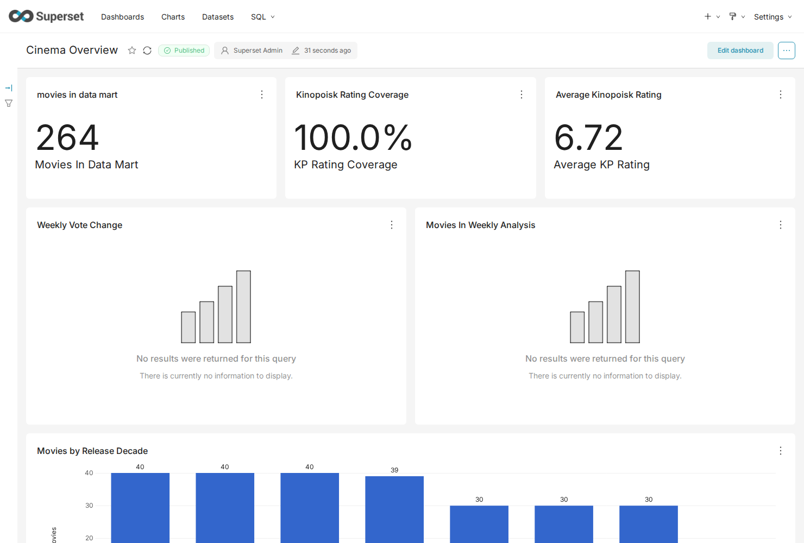
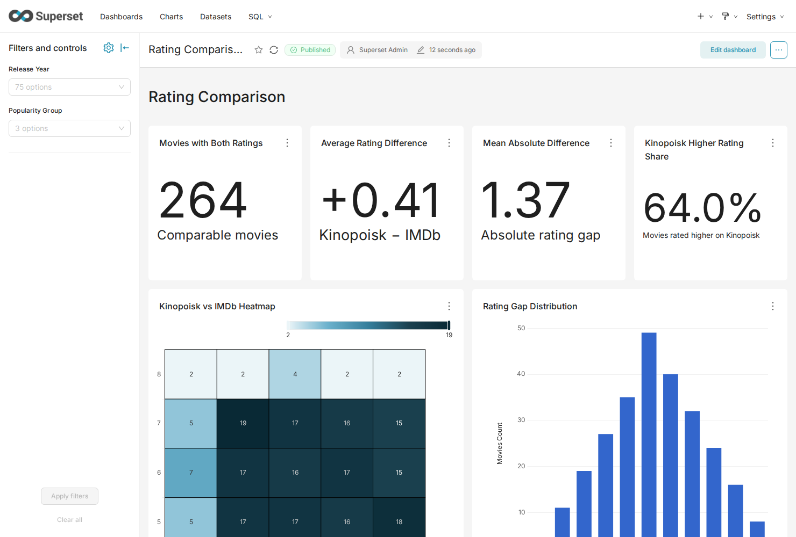

# Apache Superset

Superset строит графики и дашборды по опубликованным витринам ClickHouse.
В Compose профиль `bi` добавляет веб-приложение и PostgreSQL для его метаданных.

## Запуск

Заполните `SUPERSET_SECRET_KEY`, `SUPERSET_DB_PASSWORD` и
`SUPERSET_ADMIN_PASSWORD` в `.env`. Для ключа и каждого пароля можно отдельно
выполнить `openssl rand -hex 32`. Сохраняйте один и тот же `SUPERSET_SECRET_KEY`
между запусками. Superset использует его для шифрования учётных данных источников.

Если основной стек уже запущен, из корня проекта соберите образ Superset и
дождитесь готовности сервиса:

```bash
docker compose --profile bi up -d --build --wait superset
docker compose --profile bi ps -a superset superset-init superset-db
```

При повторном запуске с уже собранным образом можно использовать `--no-build`
вместо `--build`.

При полном запуске `docker compose --profile bi up -d --build` Compose также
запускает `superset-bootstrap`: он ждёт успешную daily публикацию, импортирует
версионируемые активы и проверяет запросы датасетов. Требуется отдельный
`CLICKHOUSE_READER_PASSWORD` в `.env`; `warehouse-init` создаёт reader с SELECT
только к двум рейтинг/популярность витринам.

`superset-init` применяет миграции, обновляет роли и при первом запуске создаёт
пользователя `admin`. После завершения `superset-init` с кодом 0 и перехода
`superset` в `healthy` откройте **http://localhost:8088** и войдите как `admin`
с паролем `SUPERSET_ADMIN_PASSWORD`. После создания пользователя меняйте его
пароль через интерфейс Superset. Дашборды, датасеты и подключения сохраняются
в томе `superset-db-data`.

При повторном запуске bootstrap восстанавливает отсутствующие управляемые
объекты и сохраняет UI-заголовки и раскладку. Чтобы явно применить настройки
объектов из Git:

```bash
docker compose --profile bi run --rm --no-deps superset-bootstrap --overwrite
```

Нужны доступный Superset, успешная публикация и доступный Airflow.

## Подключение к ClickHouse

`warehouse-init` создаёт `superset_reader` и выдаёт доступ к
`mart_movie_scores_current` и `mart_movie_popularity_weekly`. При ручном
создании или смене секрета используйте ClickHouse admin account:

```bash
docker compose exec clickhouse sh -c \
  'clickhouse-client --user "$CLICKHOUSE_USER" --password "$CLICKHOUSE_PASSWORD"'
```

Замените `your_generated_password` отдельным паролем для `superset_reader`.

```sql
CREATE USER IF NOT EXISTS superset_reader IDENTIFIED WITH sha256_password BY 'your_generated_password';
GRANT SELECT ON mart.mart_movie_scores_current TO superset_reader;
GRANT SELECT ON mart.mart_movie_popularity_weekly TO superset_reader;
```

В Superset откройте **Settings → Database Connections → + Database**. Выберите
**ClickHouse** и переключитесь на подключение по **SQLAlchemy URI**. Проверьте
подключение через **Test Connection**, затем сохраните его.

```text
clickhousedb://superset_reader:<пароль>@clickhouse:8123/mart
```

Для специальных символов в пароле используйте URL-кодирование. Здесь
`clickhouse:8123` — адрес сервиса внутри сети Compose.

После [создания и публикации витрин](../clickhouse/README.md) проверьте запрос в
**SQL Lab** или добавьте `mart.mart_movie_scores_current` через **Datasets**.

```sql
SELECT count() FROM mart.mart_movie_scores_current;
```

Дашборды используют native filters. Горизонтальная фильтрация графиков по
выбору значений в другом графике (cross-filtering) не реализована и этим smoke
не проверялась; используйте панель фильтров.

## Проверенный smoke

Отчёт D от 28 ноября 2026 проверял интеграцию на отдельном локальном стенде с
PoiskKino API-фикстурой. Это подтверждает работу цепочки на контролируемом
ответе, но не реальное API, полный catchup или исторический архив. T01 прошёл
частично: сборка образа остановилась на сетевой ошибке Docker Hub, после чего
готовые образы позволили продолжить Compose. Один daily интервал обработал 264
фильма; Spark cleaning, staging, ClickHouse публикация и 104 dbt data tests
успешны. Superset bootstrap успешно импортировал 1 database, 3 datasets, 21
metrics, 18 charts, 3 опубликованных dashboards и 7 native filters; все три
dataset query прошли.

На экране два недельных графика были пусты, потому что фикстура содержала
неполную неделю. Movie Analytics показал ошибку datasource metadata HTTP 422
(T09), поэтому его скриншот исключён до ретеста исправления. Полное применение
всех фильтров, горизонтальное cross-filtering и полный catchup не проверены.
T10 и T12 частичны; поведение T11 подтверждено предыдущим прогоном C. Отчёт и
логи остаются в каталоге временных артефактов тестового прогона, не в Git.

## Research Findings

Все числа ниже относятся только к синтетической выборке из 264 фильмов,
собранной тестовым API-ответом 28 ноября 2026; это не исследование реального
каталога или временного тренда. У 264 фильмов были оба рейтинга; 169 (64.0%)
имели более высокий рейтинг Kinopoisk. Средняя разница Kinopoisk − IMDb была
`+0.4087`, средняя абсолютная разница — `1.3722`. Недельные показатели на
снимках пусты из-за неполной недели. Экспортированные ранее числа 26 529,
71.9% и +0.38 этим прогоном не подтверждены.

Проверенные скриншоты:





## Остановка

Чтобы остановить BI и сохранить подключения и дашборды, выполните:

```bash
docker compose --profile bi stop superset superset-db
```

Для резервной копии metadata PostgreSQL:

```bash
docker compose --profile bi exec -T superset-db \
  pg_dump -U superset -Fc superset > superset-metadata.dump
```

Восстанавливайте в пустую базу после запуска `superset-db`:

```bash
cat superset-metadata.dump | docker compose --profile bi exec -T superset-db \
  pg_restore -U superset -d superset --clean --if-exists
```

Храните `.env` отдельно: `SUPERSET_SECRET_KEY` нужен для расшифровки сохранённых
секретов подключений. Бэкап прочих данных описан в
[руководстве стенда](../README.md#резервная-копия-и-восстановление).

## Диагностика

```bash
docker compose --profile bi logs --tail=100 superset-init superset superset-db
```

Описание драйвера и формата подключения — в
[документации Superset](https://superset.apache.org/docs/databases/supported/clickhouse/).
